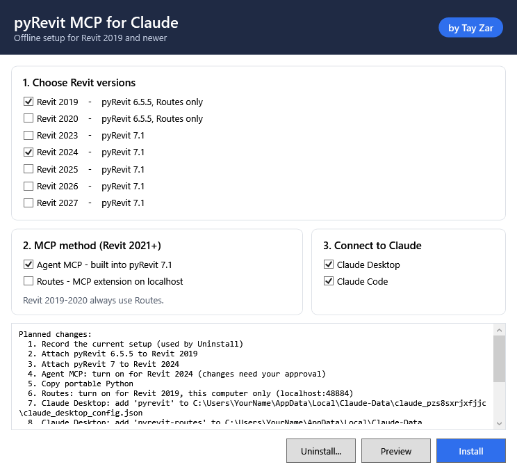

# pyRevit MCP for Claude: All-in-One Installer

*by Tay Zar*

Connect **Claude** to **Autodesk Revit** with one offline Windows setup file. It installs pyRevit, sets up the MCP connection and writes the Claude configuration for you.

> **Pre-release.** Tested on one development PC only. Try it on a test machine and a copy of your model first.

> **Unofficial project.** Not made or endorsed by pyRevit Labs, Autodesk or Anthropic.

## Features

- Pick the **Revit versions** to set up (2019 and newer).
- Two connection methods: **Agent MCP** (built into pyRevit 7.1) and **Routes** (MCP extension).
- Writes the config for **Claude Desktop** and **Claude Code**, keeping your other entries.
- **Offline install** of pyRevit, Python and Python packages. No `uv` or `pip` needed.
- **Preview** shows every change before anything happens.
- **Uninstall** removes what the installer added. A separate, opt-in mode removes setups made another way.
- Routes requests require a **secret key**.

## Quick start

1. Download `PyRevitMCP-Setup.exe` from the **Releases** page.
2. Save your work, close all Revit windows and **quit Claude** (tray icon → Quit).
3. Run the EXE, tick your Revit versions, click **Preview**, then **Install**.
4. Open Revit with a project, then open Claude.
5. Ask: *"List the levels in my Revit model. Read only."*

Full instructions with pictures: **[Step-by-step tutorial](docs/TUTORIAL.md)**

## Requirements

| Item | Needed |
|---|---|
| Windows | Windows 10 or 11, 64-bit |
| Revit | 2019 or newer, already installed |
| Claude | Claude Desktop and/or Claude Code, with your own account |
| Internet | Not for installing; **yes** for using Claude |
| Admin rights | The installer does not ask for them |

## Which method?

| | Agent MCP | Routes |
|---|---|---|
| Revit | 2021 and newer | 2019 and newer (the only choice for 2019–2020) |
| pyRevit | 7.1 | 6.5.5 for 2019–2020, 7.1 for newer |
| Connection | Local named pipe | `localhost:48884` with a secret key |
| Approving changes | pyRevit asks Keep or Discard | Claude's permission prompts only |
| Several Revit sessions | See pyRevit documentation | Use **one Revit at a time** |
| Name in Claude | `pyrevit` | `pyrevit-routes` |

## Test status

| Area | Status |
|---|---|
| Routes on Revit 2019 | Status, levels, view info, view image and read-only code worked |
| Routes on Revit 2024 | Status, view info and read-only code worked |
| Claude Desktop and Claude Code with `pyrevit-routes` | Connected on the development PC |
| Agent MCP set up by this installer | **Not verified** |
| Revit 2020, 2023, 2025–2027 | **Not tested** |
| Tools that change the model | **Not tested** |
| Clean PC, offline | **Not tested** |
| Uninstall | Simulated tests pass. One real "existing setup" removal found bugs that were fixed; the fixed version has not been re-run for real |

## Documentation

- [Tutorial: install, use, uninstall, troubleshoot](docs/TUTORIAL.md)
- [Build the EXE from source](docs/BUILD.md)
- [Security notes](SECURITY.md)
- [Third-party software and licenses](THIRD-PARTY-NOTICES.md)

## Credits

- [pyRevit](https://github.com/pyrevitlabs/pyRevit) by pyRevit Labs and contributors
- [mcp-server-for-revit-python](https://github.com/mcp-servers-for-revit/mcp-server-for-revit-python) by Juan Rodriguez and contributors (MIT), included here with changes

## License

The installer is released under the MIT License (see the `LICENSE` file). Bundled third-party software keeps its own licenses; see [Third-party software and licenses](THIRD-PARTY-NOTICES.md).
