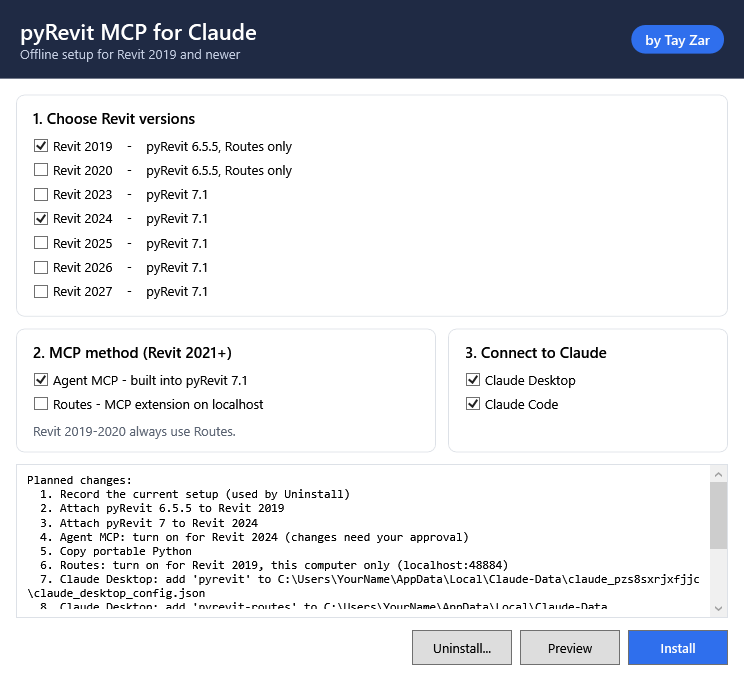
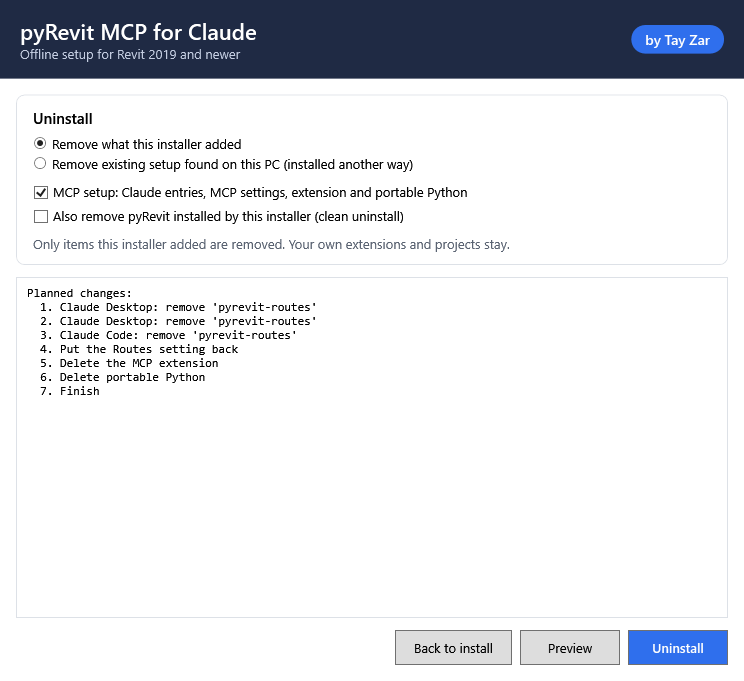
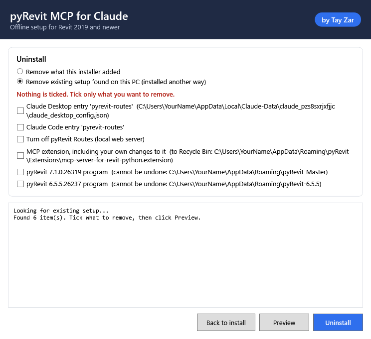

# Step-by-step tutorial

- [Before you start](#before-you-start)
- [If you already have pyRevit](#if-you-already-have-pyrevit)
- [Step 1: Download and check the file](#step-1-download-and-check-the-file)
- [Step 2: Close Revit and Claude](#step-2-close-revit-and-claude)
- [Step 3: Start the installer](#step-3-start-the-installer)
- [Step 4: Choose your setup](#step-4-choose-your-setup)
- [Step 5: Preview and install](#step-5-preview-and-install)
- [Step 6: Start Revit, then Claude](#step-6-start-revit-then-claude)
- [Step 7: Check the connection](#step-7-check-the-connection)
- [Step 8: First prompts](#step-8-first-prompts)
- [Uninstall](#uninstall)
- [Troubleshooting](#troubleshooting)

## Before you start

You need Windows 10 or 11 (64-bit), Revit 2019 or newer, and Claude Desktop or Claude Code installed and signed in.

Work on a **copy** of your model while you are learning.

## If you already have pyRevit

You can usually keep it. The installer checks which pyRevit each Revit version loads, and **Preview** tells you what will change.

| You already have | You tick | What happens |
|---|---|---|
| pyRevit 7.x in `%APPDATA%\pyRevit-Master` | Revit 2021+ | Reused, and MCP is added |
| An older pyRevit in `%APPDATA%\pyRevit-Master` | Revit 2021+ | **Upgraded to 7.1.** Uninstall cannot bring the old version back |
| An older pyRevit in `%APPDATA%\pyRevit-Master` | Revit 2019-2020 only | Kept; a separate 6.5.5 is installed. Check Preview for notes |
| pyRevit in `%APPDATA%\pyRevit-6.5.5` | Revit 2019-2020 | Reused |
| pyRevit 7.x only | Revit 2019-2020 | 6.5.5 is added for those versions |
| pyRevit in another folder of your user account | Any ticked version | That version switches to the installer's pyRevit. The old folder is not deleted |
| pyRevit installed **for all users** | A version that loads it | **Blocked.** Untick the version, or ask an administrator to remove that pyRevit |

Revit versions you do not tick keep their current pyRevit. Your other extensions are not removed. With the Routes method, the installer changes the Routes settings to `localhost`, port 48884, with the core API off.

## Step 1: Download and check the file

From the **Releases** page, download `PyRevitMCP-Setup.exe`.

In PowerShell, in your download folder, run:

```powershell
Get-FileHash .\PyRevitMCP-Setup.exe -Algorithm SHA256
```

The result must match the SHA-256 value on the release page. If it differs, delete the file.

## Step 2: Close Revit and Claude

1. Save your work and close **all** Revit windows.
2. Quit Claude: right-click its icon near the clock (it may be behind the **^** arrow) and choose **Quit**. Closing the window is not enough.

The installer refuses to continue while they are running.

## Step 3: Start the installer

Double-click `PyRevitMCP-Setup.exe`. Unpacking takes a moment.

The EXE is not code-signed, so Windows may show **"Windows protected your PC"**. Only after the hash in Step 1 matches, click **More info → Run anyway**. On a work computer, ask your IT team first.

An opening animation plays. Click it to skip.


## Step 4: Choose your setup



**1. Revit versions.** Tick every version you want to connect. Only versions found on your PC are listed.

**2. MCP method** (Revit 2021 and newer):

| You tick | Result |
|---|---|
| **Agent MCP** (recommended by the author for newer Revit) | Entry `pyrevit`. Changes need Keep or Discard in Revit |
| **Routes** | Entry `pyrevit-routes`. Same tools as the 2019–2020 setup |

Revit 2019–2020 always use Routes.

**3. Claude.** Keep **Claude Desktop** and/or **Claude Code** ticked.

## Step 5: Preview and install

1. Click **Preview** and read the planned changes. Nothing is changed yet.
2. If you see `CANNOT CONTINUE YET`, fix what it says (usually Revit or Claude still running) and preview again.
3. Click **Install**, then **Yes**.
4. Wait for **DONE**.

## Step 6: Start Revit, then Claude

1. Start Revit and wait until pyRevit has loaded.
2. Open a project.
3. Start Claude.

## Step 7: Check the connection

**Claude Desktop:** open **Settings**, then the desktop-app page that shows **Local MCP servers** (its name differs between versions). You should see your entry. It does not appear in the online Connectors list.

**Claude Code:**

```powershell
claude mcp list
```

Your entry should show **Connected**.

## Step 8: First prompts

Start with read-only requests:

- "Check the Revit status."
- "List the levels in this model with their elevations. Read only."
- "How many walls are in this model? Don't change anything."
- "Show me the current view."

When you ask for changes, read Claude's permission prompt before allowing it. With Agent MCP, also check the highlighted elements before choosing **Keep**.

## Uninstall

Close Revit, quit Claude, run the EXE and click **Uninstall...**. The installer keeps a record on your PC of what it added.

### Remove what this installer added



- **MCP setup:** Claude entries, settings, extension and portable Python.
- **Also remove pyRevit:** also removes pyRevit versions this installer installed, and puts Revit back as before.

### Remove existing setup (installed another way)



Nothing is ticked. Tick only what you want gone, click **Preview**, then **Uninstall**. The MCP extension goes to the Recycle Bin. **Removing a pyRevit program cannot be undone** by the installer.

## Troubleshooting

| Problem | What to do |
|---|---|
| "Claude Desktop is running" | Quit from the tray. If it persists, end Claude in Task Manager or restart Windows |
| "Revit is running" | Close all Revit windows |
| "An older MCP extension without the security key is installed" | Rename or remove the folder shown, then install again |
| No server listed in Claude Desktop | Install again with Claude Desktop ticked. In Preview, note the config path, and compare it with the file opened by **Edit config** |
| `401 Unauthorized` | Claude is still running an old server. Quit Claude completely and reopen |
| "No active Revit document" | Open a project in Revit |
| Routes does not answer | Keep only one Revit open, then restart it |
| Browser shows `Unauthorized` at `localhost:48884` | Expected. Routes only accepts requests with the secret key |
| No pyRevit tab in a Revit version | Run the installer again and tick that version |
| pyRevit files are "in use" | Quit Claude, then try again |

When you report a problem, include the text from the installer window, your Revit version and the method you chose. Remove personal folder names, and **never share** the file `mcp_routes.key`.
